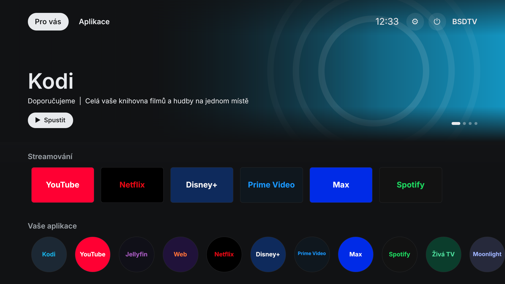
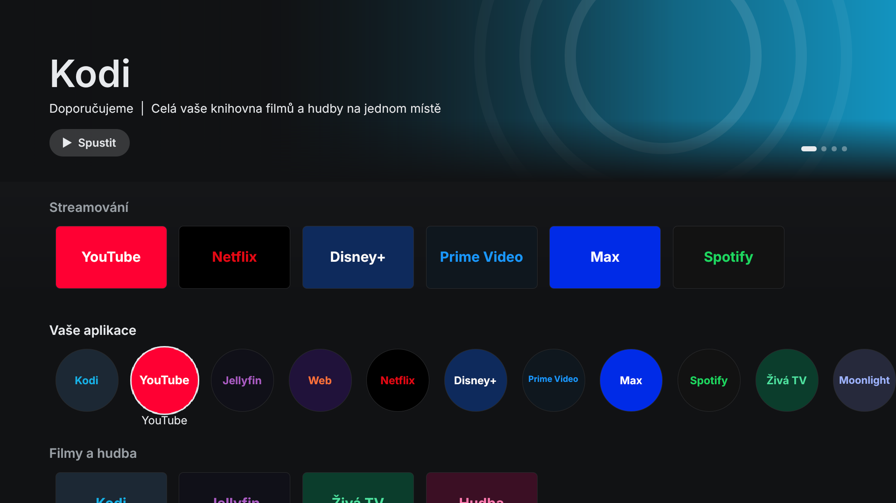
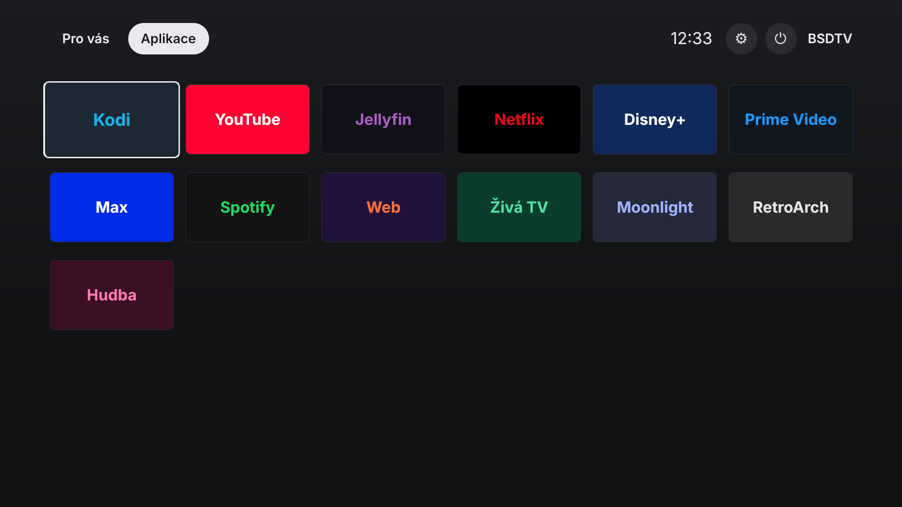

# BSDTV

**Chytrá televize, která vás nešpehuje. Postavená na FreeBSD.**

BSDTV udělá z libovolného malého PC (NUC, mini PC, starý notebook) s FreeBSD
čistý TV box bez reklam: klidná domovská obrazovka ve stylu Apple TV, vaše
aplikace, ovladač v mobilu, HDMI-CEC pro ovladač od televize a volitelné
blokování reklam pro celou domácí síť. Žádné účty, žádná telemetrie, žádné
placené „doporučené" řádky.

[English](README.md)



Inspirováno projektem [CleanYourTV](https://github.com/Gathin23/cleanyourtv),
který čistí Android TV od bloatwaru. BSDTV jde opačnou cestou: místo čištění
systému televize si přinese vlastní, postavený na FreeBSD, kde od začátku
nic zbytečného není.

## Co dostanete

- **Domovská obrazovka jako u dnešních chytrých TV** (Google TV apod.):
  záložky „Pro vás" a „Aplikace", rotující banner přes celou šířku, pod ním
  řady karet (streamování, filmy a hudba, hry) a „Vaše aplikace" jako kulaté
  ikony. Tmavé grafitové barvy a ploché dlaždice v barvách jednotlivých
  značek. Ovládání šipkami, OK, Zpět a Domů. Pět barevných motivů. Jednodušší
  „klasická" obrazovka (hodiny, dok a mřížka) se zapne v Nastavení.
- **Čeština a angličtina**, podle jazyka systému nebo volby v Nastavení.
- **Aplikace**: Kodi, YouTube (TV rozhraní, s uBlock Origin), Jellyfin,
  prohlížeč, IPTV a hudba v mpv, Moonlight (streamování her), RetroArch.
  Zobrazí se jen nainstalované; vlastní aplikace přidáte jedním záznamem v JSON.
- **Netflix, Disney+, Prime Video, Max, Spotify** (volitelně, `--drm`):
  přes Linuxovou verzi Brave s Widevine, běžící v linuxové kompatibilitě
  FreeBSD. Brave Shields blokují reklamy i tam.
- **Vždy jedna aplikace**, jako u skutečné TV: tlačítko Domů ji zavře a vrátí
  domovskou obrazovku.
- **Ovladač v mobilu**: otevřete adresu (spárovanou kódem z TV) a máte
  šipky, přehrávání, hlasitost, psaní do vyhledávání i zkratky aplikací.
  Nic se neinstaluje.
- **HDMI-CEC**: ovladač od televize přes USB-CEC adaptér (libcec).
- **Blokování reklam pro celou domácnost** (volitelné): `local_unbound`
  z FreeBSD s veřejnými seznamy, aktualizace každý týden.
- **Startuje rovnou do TV**: automatické přihlášení, žádný display manager,
  2 s v boot menu, tichý start.
- **Vratné**: každá změna se zapisuje do `/var/db/bsdtv`, `uninstall.sh`
  vrátí systém do původního stavu.

| Řady | Aplikace | Klasická obrazovka |
| --- | --- | --- |
|  |  |  |

## Instalace

Potřebujete 64bitové PC s FreeBSD 14 nebo novějším (stačí minimální instalace;
co funguje dobře, popisuje [docs/HARDWARE.md](docs/HARDWARE.md)). Jako root:

```sh
pkg install -y git
git clone https://github.com/martinfx/BSDTV.git
cd BSDTV
sh install.sh            # volitelně --adblock, --ssh, --apps "kodi firefox mpv moonlight-qt"
shutdown -r now
```

Instalátor se jednou zeptá, než cokoli změní. `sh install.sh --dry-run`
ukáže všechny kroky bez provedení.

| Volba | Význam |
| --- | --- |
| `--apps "SEZNAM"` | balíčky aplikací (výchozí `kodi firefox mpv`) |
| `--gpu TYP` | `auto`, `intel`, `amd`, `nvidia` nebo `generic` |
| `--adblock` | blokování reklam v celé síti přes `local_unbound` |
| `--drm` | streamovací služby s Widevine přes `linux-brave` (viz níže) |
| `--ssh` | zapne sshd pro vzdálenou správu |
| `--audio-unit N` | zvuk na `pcmN` (HDMI často není 0, viz `cat /dev/sndstat`) |
| `--user JMÉNO` | účet, pod kterým TV běží (výchozí `tv`) |

### S pomocí AI asistenta

Stejně jako u CleanYourTV můžete nastavení svěřit asistentovi s přístupem
k terminálu (Claude Code, Codex, Gemini CLI). Na boxu zapněte SSH a vložte
asistentovi obsah [PROMPT.md](PROMPT.md).

### Netflix a další služby s DRM

Netflix, Disney+, Prime Video, Max a Spotify hrají jen v prohlížeči s
Widevine. Firefox na FreeBSD ho nemá, ale Linuxová verze Brave
(`linux-brave`, běží přes Linuxulator) ho umí načíst z portu
`www/linux-widevine-cdm`. `install.sh --drm` to nastaví: zapne linuxovou
kompatibilitu, nainstaluje `linux-brave`, sestaví Widevine z portů a zobrazí
dlaždice streamovacích služeb.

Widevine nemá binární balíček (licence ho nedovoluje šířit), proto je předem
potřeba strom portů: `git clone --depth 1 https://git.FreeBSD.org/ports.git /usr/ports`.

Omezení: jde o softwarový Widevine (L3), takže služby pustí nižší rozlišení
(Netflix v prohlížeči obvykle max. 720p, bez 4K a HDR). Závisí na linuxových
binárkách, které FreeBSD oficiálně nepodporuje, takže ho aktualizace Brave
nebo Widevine může rozbít. Když Brave nenaběhne, zkuste v `~tv/.xinitrc`
`BSDTV_BRAVE_FLAGS=--no-sandbox` (oslabí to sandbox prohlížeče).

## Ovládání

| Ovladač / klávesnice | Domovská obrazovka | V aplikaci |
| --- | --- | --- |
| Šipky, OK (Enter) | pohyb, spuštění | předá se aplikaci |
| Zpět (Esc) | odchod z mřížky, zavření panelů | předá se aplikaci |
| Domů (`XF86HomePage`, `F12`, `Super+H`) | – | zavře aplikaci |
| Menu | nastavení | předá se aplikaci |
| Hlasitost | hlasitost (`mixer`) | hlasitost |

Ovladač v mobilu: na TV otevřete **Nastavení** a adresu odtud zadejte v mobilu
ve stejné síti. Část `?t=` je párovací kód.

Z příkazové řádky (jako uživatel `tv` nebo přes SSH):

```sh
bsdtv-ctl apps
bsdtv-ctl launch kodi
bsdtv-ctl key down down ok
bsdtv-ctl text "dokumenty o přírodě"
bsdtv-ctl home
bsdtv-ctl theme aurora
bsdtv-ctl url
```

## Nastavení

- `/usr/local/etc/bsdtv/config.json`: systémové výchozí hodnoty (dok, motiv,
  adresa Jellyfinu, IPTV playlist, složka s hudbou, CEC, port ovladače).
- `~tv/.config/bsdtv/config.json`: uživatelské změny; sem zapisuje panel
  Nastavení.
- `apps.json`: katalog aplikací, `themes/<název>/theme.json`: motivy.

Všechny volby, přidání aplikace a tvorbu motivů popisuje
[docs/CONFIG.md](docs/CONFIG.md).

## Vývoj

Launcher běží všude, kde je PySide6:

```sh
python3 -m venv .venv && .venv/bin/pip install PySide6-Essentials pytest
.venv/bin/python -m bsdtv --windowed
.venv/bin/python -m pytest
```

## Licence

BSD 2-Clause, viz [LICENSE](LICENSE).
