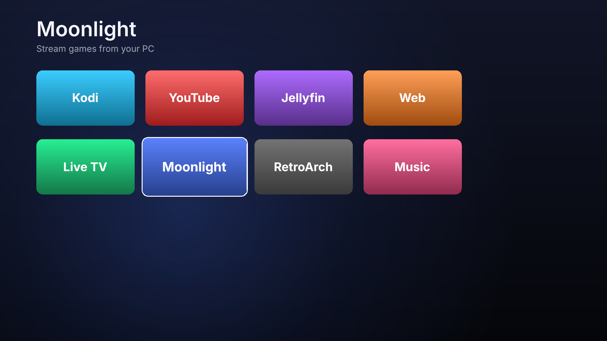
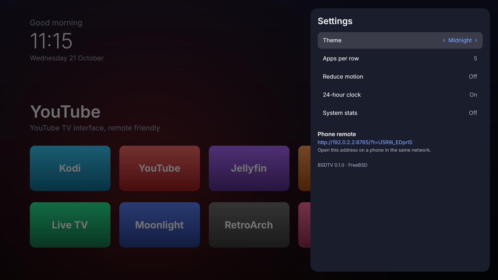
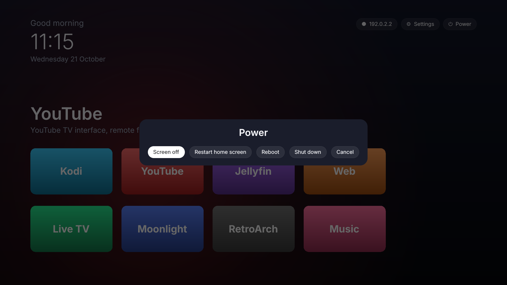

# BSDTV

**A smart TV that doesn't spy on you, built on FreeBSD.**

BSDTV turns any small PC (a NUC, a mini PC, an old laptop) running FreeBSD into
a clean, ad-free TV box: a calm Apple TV–style home screen, your apps, a remote
on your phone, HDMI-CEC for the TV's own remote, and optional network-wide ad
blocking. No accounts, no telemetry, no content rows paid for by someone else.

[Česky](README.cs.md)


Inspired by [CleanYourTV](https://github.com/Gathin23/cleanyourtv), which
debloats Android TVs. BSDTV takes the other route: instead of cleaning up a
TV's operating system, it brings its own, starting from a FreeBSD base that has
nothing to remove in the first place.

## What you get

- **Home screen**: big clock and greeting, a dock of four favourite apps, the
  full app grid one press of ↓ away, an ambient glow taken from the focused app.
  Made for a remote: arrows, OK, Back, Home. Four themes.
- **Apps**: Kodi, YouTube (the TV interface, with uBlock Origin), Jellyfin, a
  web browser, IPTV and a music folder in mpv, Moonlight game streaming,
  RetroArch. Only installed apps are shown; adding your own is a JSON entry.
- **Netflix, Disney+, Prime Video, Max, Spotify** (optional, `--drm`): through
  the Linux build of Brave with Widevine, running on FreeBSD's Linux
  compatibility layer. Brave Shields block ads there too.
- **One app at a time**, like a real TV: Home closes the running app and
  brings back the home screen.
- **Phone remote**: open a URL on your phone (paired with a code shown on the
  TV) for a D-pad, media keys, volume, typing into search boxes and app
  shortcuts. No app to install.
- **HDMI-CEC**: use the TV's own remote through a USB-CEC adapter (libcec).
- **Ad blocking for the whole home** (optional): FreeBSD's `local_unbound`
  with public block lists, refreshed weekly.
- **Boots straight into the TV**: autologin on the console, no display manager,
  boot menu delay cut to 2 seconds, quiet boot.
- **Reversible**: every change is recorded in `/var/db/bsdtv`;
  `uninstall.sh` puts the system back.

| Apps | Settings | Power |
| --- | --- | --- |
|  |  |  |

## Install

You need a 64-bit PC with FreeBSD 14 or newer installed (a minimal install is
enough; see [docs/HARDWARE.md](docs/HARDWARE.md) for what works well). Then, as
root:

```sh
pkg install -y git
git clone https://github.com/martinfx/BSDTV.git
cd BSDTV
sh install.sh            # add --adblock, --ssh, --apps "kodi firefox mpv moonlight-qt"
shutdown -r now
```

The installer asks once before it changes anything. Run `sh install.sh --dry-run`
first if you want to see every step.

| Option | Meaning |
| --- | --- |
| `--apps "LIST"` | app packages to install (default `kodi firefox mpv`) |
| `--gpu TYPE` | `auto`, `intel`, `amd`, `nvidia` or `generic` |
| `--adblock` | network-wide ad blocking with `local_unbound` |
| `--drm` | streaming services that need Widevine, via `linux-brave` (see below) |
| `--ssh` | enable sshd for remote administration |
| `--audio-unit N` | send sound to `pcmN` (HDMI is often not unit 0, see `cat /dev/sndstat`) |
| `--user NAME` | account that runs the TV (default `tv`) |

### Let an AI assistant do it

Like CleanYourTV, BSDTV is easy to set up with a coding assistant that has
shell access (Claude Code, Codex, Gemini CLI). Enable SSH on the box, then paste
[PROMPT.md](PROMPT.md) into the assistant on your computer.

## Using it

| Remote / keyboard | Home screen | In an app |
| --- | --- | --- |
| Arrows, OK (Enter) | move, open | passed to the app |
| Back (Esc) | leave the grid, close panels | passed to the app |
| Home (`XF86HomePage`, `F12`, `Super+H`) | – | close the app, back home |
| Menu | settings | passed to the app |
| Volume keys | volume (via `mixer`) | volume |

Phone remote: open **Settings** on the TV and visit the address shown there
from a phone on the same network. The `?t=` part is the pairing code.

From a shell (as the `tv` user or over SSH):

```sh
bsdtv-ctl apps                # list installed apps
bsdtv-ctl launch kodi
bsdtv-ctl key down down ok
bsdtv-ctl text "nature documentaries"
bsdtv-ctl home
bsdtv-ctl theme aurora
bsdtv-ctl url                 # phone remote address
```

## Configuration

- `/usr/local/etc/bsdtv/config.json`: system defaults (dock, theme, Jellyfin
  URL, IPTV playlist, music folder, CEC, remote port).
- `~tv/.config/bsdtv/config.json`: per-user overrides; the Settings panel
  writes here.
- `/usr/local/etc/bsdtv/apps.json` and `~tv/.config/bsdtv/apps.json`: the
  app catalogue.
- `/usr/local/etc/bsdtv/themes/<name>/theme.json`: themes (colours and an
  optional wallpaper).

See [docs/CONFIG.md](docs/CONFIG.md) for every option, adding apps and making
themes.

## How it works

```
 FreeBSD boot ─▶ getty autologin (ttyv0) ─▶ startx ─▶ openbox (invisible WM)
                                                   └▶ bsdtv-session ─▶ bsdtv launcher (PySide6 + QML)
                                                                         ├─ starts apps in their own process group
                                                                         ├─ HTTP API + phone remote on :8765
                                                                         └─ bsdtv-cec ─ libcec ─ TV remote
```

- `bsdtv/`: the launcher (Python, PySide6/QML). `backend.py` exposes apps,
  settings and theme to QML; `runner.py` keeps one app in the foreground;
  `remote.py` serves the phone remote and the JSON API; `cec.py` bridges CEC.
- `system/`: session files (xinitrc, openbox config, autologin, Firefox policies).
- `tools/adblock-update.sh`: builds the unbound block list.
- `install.sh` / `uninstall.sh`: setup and undo.

## Development

The launcher runs on any OS with PySide6, which is handy for working on the UI:

```sh
python3 -m venv .venv && .venv/bin/pip install PySide6-Essentials pytest
.venv/bin/python -m bsdtv --windowed          # arrow keys + Enter, F12 has no effect outside openbox
.venv/bin/python -m pytest
```

Apps only appear when their binary is on `PATH`, so on a dev machine you may see
an empty grid until you install e.g. `mpv` or `firefox`.

## Security notes

- The phone remote listens on all interfaces (port 8765). LAN clients must
  present the pairing code; localhost is trusted. Set
  `"remote": {"bind": "127.0.0.1"}` to turn LAN access off, or
  `"enabled": false` to disable it.
- The `tv` account has no password and can only log in on the console. Its
  only root privilege is `doas /sbin/shutdown`.
- To change the pairing code, delete `~tv/.config/bsdtv/remote-token` and
  restart the home screen.

## Status and roadmap

BSDTV is young. Ideas for what comes next:

- prebuilt USB image (poudriere / `release(7)`), so no FreeBSD install is needed
- translations (the UI strings are ready for `qsTr`)
- app icons and a "continue watching" row from Kodi/Jellyfin
- Wayland session (cage or labwc) once FreeBSD's Wayland apps are mature enough
- Bluetooth remotes and game controllers out of the box

## Netflix and other DRM services

Netflix, Disney+, Prime Video, Max and Spotify only play in a browser with the
Widevine CDM. Firefox on FreeBSD has none, but the Linux build of Brave
(`linux-brave`, running on the Linuxulator) can load it from the
`www/linux-widevine-cdm` port. `install.sh --drm` sets this up:

1. enables Linux compatibility (`linux_enable=YES`)
2. installs `linux-brave`
3. builds `www/linux-widevine-cdm` from the ports tree. It has no binary
   package because Widevine may not be redistributed, so get the ports tree
   first: `git clone --depth 1 https://git.FreeBSD.org/ports.git /usr/ports`
4. installs `bsdtv-drm-browser` (Brave in kiosk mode with its own profile) and
   sets `vars.drm_browser`, which makes the streaming tiles appear

Limits: this is software Widevine (L3), so services stream in reduced
resolution (Netflix in a browser typically tops out at 720p, no 4K or HDR).
It depends on Linux binaries that FreeBSD does not support officially, so a
Brave or Widevine update can break it. If Brave will not start, try
`BSDTV_BRAVE_FLAGS=--no-sandbox` in `~tv/.xinitrc` (this weakens Brave's
sandbox).

## License

BSD 2-Clause, see [LICENSE](LICENSE).
